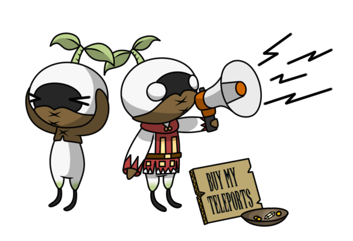
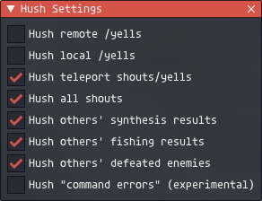

# Installation
Install to your addons folder (e.g. `.\HorizonXI\Game\addons\hush\hush.lua`).

## Usage
* `/hush`: Opens a GUI with options for filtering certain messages.

GM shouts and yells, and HorizonXI's hardcore-death announcements, are never hushed, even with "Hush all shouts" turned on.

## Using other chat addons
If you use an addon that shows chat in its own window, such as FancyChat, load Hush **before** it in your Ashita default script. Otherwise that addon picks up each message before Hush gets a chance to hush it.

**SimpleLog:** "Hush others' defeated enemies" doesn't work while SimpleLog is loaded. The game marks a defeat message differently depending on who got the kill (you, your party, or someone else), and Hush uses that to find other players' defeats. SimpleLog replaces the game's battle messages with its own and marks every defeat as if it were yours, so Hush can't tell them apart. To hide other players' battle messages with SimpleLog, use the `others` section of SimpleLog's own `filters.lua` instead. That hides all of their battle messages, not only defeats.

## Debug mode
If Hush isn't hiding something you think it should, debug mode records what Hush decides about each line of chat, so the problem can be tracked down.

* `/hush debug`: Starts recording the kinds of chat Hush filters.
* `/hush debug all`: Records every line of chat instead.
* `/hush debug off`: Stops recording.

The same switches are at the bottom of the `/hush` window. Debug mode isn't saved: it stops when you reload Hush, log out or change characters.

Each time you start it, Hush writes a new file to your Ashita folder's `config\addons\hush\debug\` (for HorizonXI, `.\HorizonXI\Game\config\addons\hush\debug\`), named after your character and the time. It starts with your Hush settings and the addons you have loaded, followed by one line per chat message:

```
[12:34:56] [121] hushed: synth                | Mandy synthesized a bronze ingot.
[12:34:57] [121] shown: synth off             | Mandy synthesized a bronze ingot.
```

After the time and the chat mode (in brackets), each line says what Hush did:

* **hushed: *filter*** — that filter hid the line.
* **shown** — Hush let the line through.
* **exempt: gm** or **exempt: hardcore** — a GM's message or a hardcore-death announcement, which Hush never hides.
* **pre-blocked** — another addon had already hidden the line before Hush saw it. Hush's own verdict follows after a `;`, as in `pre-blocked; shown`.
* *(blank)* — Hush doesn't filter this kind of chat (only recorded with `/hush debug all`).

Any other filters that match the line follow, with whether each is on or off: `shown: synth off` means the synthesis filter would hide the line but is turned off.

## Preview


## Experimental
The hushing of command errors should be considered "Experimental" at the moment. It could have some unforeseen false positives in its filtering so things you might want to see could get hushed by accident. Please let me know if you have this enabled and notice something missing that shouldn't be.

## Attribution
The beautiful mandragora art is used with permission from Consumelivebees <3